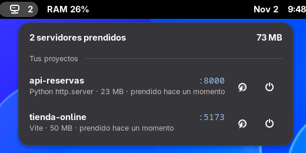

# Servidores de desarrollo

Extensión de GNOME que te avisa en la barra de arriba de los servidores de desarrollo que siguen
prendidos (Vite, Next.js, Astro, `python -m http.server`…), para que no se queden días gastando
memoria sin que lo sepas.



## Qué hace
- **En la barra**, junto al nombre de la app abierta: un ícono `</>` con cuántos servidores hay prendidos.
  Si no hay ninguno, desaparece y no ocupa lugar.
- **Al hacer clic**, la lista de servidores:
  - Proyecto (el `name` de su `package.json`, o el nombre de la carpeta) y puerto.
  - Herramienta, memoria que usa (RAM + swap, contando sus procesos hijos) y desde cuándo está prendido.
    Si lleva más de 3 horas, ese dato sale en amarillo.
  - Separados en **Tus proyectos** y **Otros programas** (los que viven en carpetas ocultas, como
    herramientas instaladas con `npm -g`), para no apagar algo que no es tuyo por error.
  - Botón **Abrir**: abre `http://localhost:<puerto>` en Brave (o en tu navegador por defecto si no
    tienes Brave).
  - Botón **Apagar**: le pide al servidor que cierre y, si a los 3 segundos sigue vivo, lo obliga.

## Cómo encuentra los servidores
Cada 10 segundos (y cada vez que abres el menú) corre `ss -ltnpH`, que lista los puertos que tus
programas tienen abiertos esperando conexiones. Se queda con los que son de Node, Bun, Deno, Python,
Ruby, PHP, Java o .NET en puertos 1024 o mayores. Así no aparecen Spotify, Claude Code ni otros
programas que también abren puertos. Nada sale de tu computadora.

## Instalar
Requisitos: GNOME Shell 48 a 51 (Wayland o X11) y el comando `ss` (paquete `iproute2`, viene en casi todas las distros).
Probada en CachyOS (Arch) con GNOME 51.

```bash
git clone https://github.com/DimitriMedNov/servidores-dev.git
cd servidores-dev
./install.sh
```

No pide sudo: todo queda en tu usuario (`~/.local/share/gnome-shell/extensions/`).
Después **cierra sesión y vuelve a entrar**. En Wayland, GNOME solo carga extensiones nuevas o
actualizadas al iniciar sesión (bloquear la pantalla no basta).

Para actualizar: `git pull` y otra vez `./install.sh` (y cerrar sesión).
Para quitarla: `./install.sh --quitar`.

## Problemas comunes
- **No la veo después de instalar.** Cierra sesión y vuelve a entrar. Si sigue sin salir, revisa que
  esté activa: `gnome-extensions info servidores-dev@dimitrimednov.github.io` debe decir `State: ACTIVE`.
- **Ver los errores:** `journalctl --user -b -o cat /usr/bin/gnome-shell | grep -i "Servidores de desarrollo"`.
- **Tu GNOME es más nuevo que 51.** Agrega tu versión a `shell-version` en
  `extension/metadata.json`, instala otra vez y prueba. Si algo falla, abre un *issue*.

## Licencia
[MIT](LICENSE). Úsala, cópiala y cámbiala como quieras.
